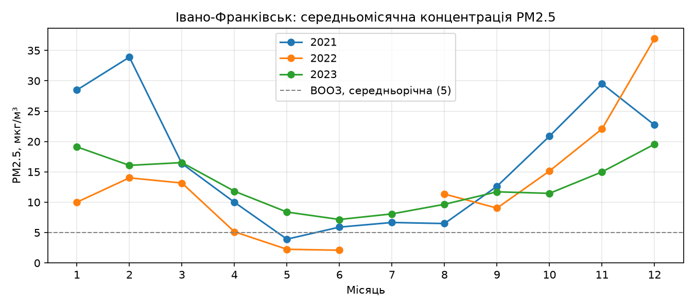
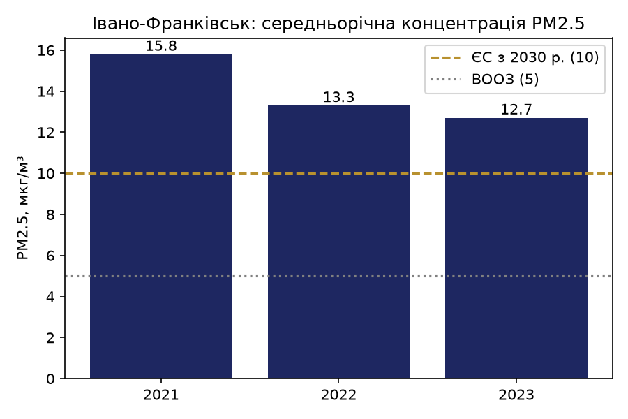
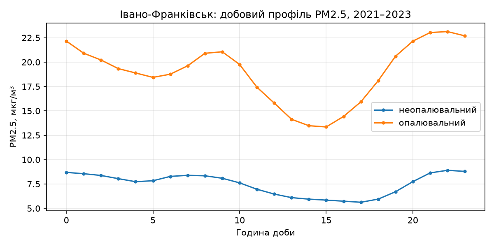

# Практична робота № 4. Відкриті міські дані та індикатори сталості

> Шаблон звіту. Замініть текст у кутових дужках своїм. Повна методика — у методичних вказівках до ПР4.

## Як запустити

```bash
python -m venv .venv
# Windows: .venv\Scripts\Activate.ps1   |   macOS/Linux: source .venv/bin/activate
pip install -r requirements.txt
python scripts/download_data.py            # для варіантів 2 і 4 додайте: --districts
jupyter notebook notebooks/pr4_kharkiv_pm25.ipynb
```

## 1. Варіант і питання дослідження
- Варіант: <№>, місто: <назва, область, city_id>
- Питання / гіпотеза: <...>

## 2. Дані
- Набір: «Щогодинні концентрації та індекс якості атмосферного повітря для дрібнодисперсного пилу фракції 2.5 мікронів в населених пунктах України», data.gov.ua, ГО «SaveDnipro», ліцензія CC BY
- Використані файли й роки: <...>

## 3. Якість даних
<таблиця повноти за місяцями; виявлені проблеми (NULL, дублікати, пропуски) і їх пояснення>

## 4. Індикатори
<таблиця індикаторів; порівняння з нормативами ВООЗ 2021 і ЄС-2030>

## 5. Графіки




## 6. Творча частина
<гіпотеза → метод → результат (власний розрахунок і графік)>

## 7. Висновки й обмеження
<висновки з конкретними числами; обмеження даних>

## 8. Журнал використання ШІ (якщо використовувався)
| Крок | Запит (суть) | Що згенеровано | Що виправлено і чому |
|---|---|---|---|
| | | | |
