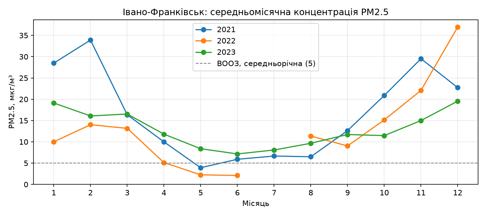
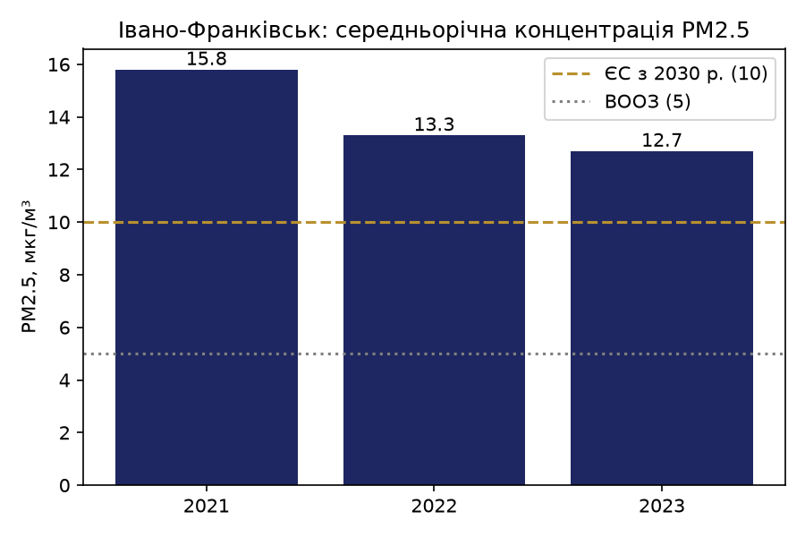
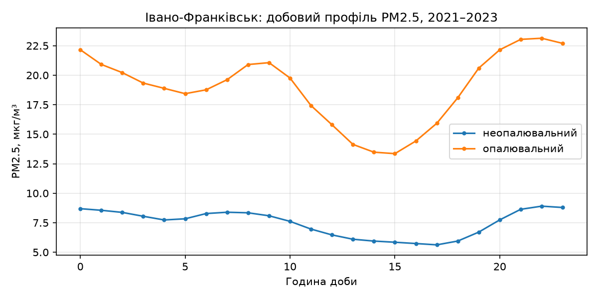
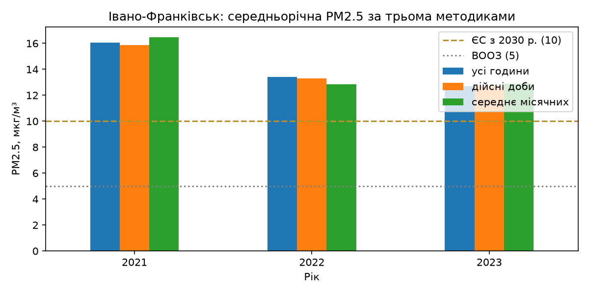

# Практична робота № 4. Відкриті міські дані та індикатори сталості

Конвеєр обробки відкритих даних про якість повітря (PM2.5) засобами Python і pandas: завантаження → очищення → оцінка якості даних → індикатори → візуалізація → експорт.

**Студентка:** Костюченко А. В., група М УП(кн) 2026-1 · **Дисципліна:** «Інноваційні інформаційні технології»

## Як запустити

```bash
cd pr4
python -m venv .venv
source .venv/Scripts/activate      # Windows (Git Bash); macOS/Linux: source .venv/bin/activate
pip install -r requirements.txt
python scripts/download_data.py    # завантаження вихідних файлів у data/raw
jupyter notebook notebooks/pr4_ivano_frankivsk_pm25.ipynb
```

Вихідні файли (≈ 113 МБ) у репозиторії не зберігаються: `data/raw/` внесено до `.gitignore`, а замість файлів є скрипт `download_data.py`, який отримує їх із відкритого джерела. Так репозиторій лишається легким, а результат відтворюваним. Результати (`data/processed/`) і графіки (`reports/figures/`) зберігаються в репозиторії.

## 1. Варіант і питання дослідження

- Варіант: **8**. Місто: **Івано-Франківськ**, Івано-Франківська область, `city_id = 3`. Період: 2021–2023 рр.
- Індикатор: середньорічна концентрація PM2.5 (ISO 37120, ЦСР 11.6.2).
- Питання / гіпотеза: у 2022 р. повнота даних становить лише близько 72 % (годинні записи). Як пропуски впливають на річне значення і чи залежить результат від методики розрахунку? Гіпотеза: що менша повнота, то більше різняться результати різних методик, тому розмах між ними у 2022 р. має бути помітно більшим, ніж у 2021 і 2023 рр.

## 2. Дані

- Набір: «Щогодинні концентрації та індекс якості атмосферного повітря для дрібнодисперсного пилу фракції 2.5 мікронів в населених пунктах України», data.gov.ua, ГО «SaveDnipro», ліцензія CC BY.
- Використані файли: довідник населених пунктів (0,1 МБ) і річні файли PM2.5 за **2021, 2022 і 2023** рр. (50,4; 32,5 та 29,8 МБ).
- Місто знайдено в довіднику за назвою, областю й типом одночасно (назви не унікальні); `assert` гарантує рівно один рядок. Відібрано **23 142** годинні записи.

## 3. Якість даних

**Діагностика.** У `pm25` виявлено 137 пропусків (NULL), 6 повних дублікатів рядків і 6 повторів години (числа збігаються: кожен повтор - повний дублікат). Після очищення (видалено повтори годин, залишено значення від 0 до 1000 мкг/м³, записи впорядковано за часом, час зроблено індексом) лишилось **22 999** записів (видалено 143), неможливих значень не було; середнє 14,1, медіана 9,2 мкг/м³.

**Повнота годинних даних за місяцями, %:**

| Місяць | 2021 | 2022 | 2023 |
|---|---|---|---|
| 1 | 100,0 | **15,6** | 98,8 |
| 2 | 100,0 | **24,3** | **73,1** |
| 3 | 99,7 | 98,8 | **76,6** |
| 4 | 100,0 | 100,0 | 100,0 |
| 5 | 100,0 | 100,0 | 100,0 |
| 6 | 100,0 | **69,4** | 100,0 |
| 7 | 99,7 | **0,0** | 100,0 |
| 8 | 97,0 | **52,3** | 100,0 |
| 9 | 95,7 | 100,0 | 100,0 |
| 10 | 89,4 | 100,0 | 100,0 |
| 11 | 80,3 | 90,3 | 100,0 |
| 12 | 87,2 | 98,8 | 100,0 |

Жирним виділено значення нижче 90 %.

**Пояснення.**
- У 2021 і 2023 рр. повнота майже в усі місяці висока; винятки - жовтень–грудень 2021 р. і лютий–березень 2023 р.
- У 2022 р. січень і лютий майже без даних, **липня немає взагалі**, червень і серпень заповнені частково.
- Найдовший пропуск - **1 319 годин**, почався 21.06.2022 о 20:00 і охоплює практично весь липень та першу половину серпня. Три пропуски січня 2022 р. передують 24.02.2022.
- Березень 2021 р. має 99,7 % через перехід на літній час: години 03:00 в останню неділю березня не існує. Це особливість даних, а не дефект.
- Відсутність липня 2022 р. виявлено в більшості міст набору (158 із 256), тобто причина, імовірно, системна; точно її за самими даними встановити неможливо (див. розділ 6).

**Середньодобові значення.** Доба вважається дійсною, якщо є щонайменше 18 з 24 годинних вимірів. Недійсних діб 153 з 1 095, з них 111 у 2022 р. (дійсних 254 з 365), 24 у 2021 р., 18 у 2023 р.

## 4. Індикатори

| Рік | Середньорічна PM2.5, мкг/м³ | Дійсних діб (з 365) | Повнота, % | Надійно | Діб > 15 | Діб > 25 | Рівень ВООЗ | У разів вище ВООЗ |
|---|---|---|---|---|---|---|---|---|
| 2021 | 15,8 | 341 | 93,4 | так | 120 | 68 | IT-2 | ≈ 3,2 |
| 2022 | 13,3 | 254 | 69,6 | **ні** | 79 | 30 | IT-3 | ≈ 2,7 |
| 2023 | 12,7 | 347 | 95,1 | так | 90 | 31 | IT-3 | ≈ 2,5 |

Порівняння з нормативами:
- Настанова ВООЗ 2021 р.: 5 мкг/м³ (рік), 15 мкг/м³ (доба, не більш ніж 3-4 перевищення на рік). Середньорічні значення перевищують її у 2,5–3,2 раза.
- Гранична величина ЄС на 2030 р. (Директива 2024/2881): 10 мкг/м³ (рік), 25 мкг/м³ (доба, не більш ніж 18 перевищень на рік). Середньорічні значення вищі в 1,3–1,6 раза; діб понад 25 мкг/м³ (68, 30, 31) більше за дозволені 18 у кожному році.
- Для 2022 р. кількості діб занижені, бо враховано лише 254 дійсні доби. Значення 13,3 мкг/м³ слід наводити лише з позначкою «повнота 69,6 %, ненадійно».

## 5. Графіки





- **Сезонність.** Максимуми середньомісячних значень - листопад–лютий (≈ 19–37 мкг/м³), мінімуми - травень–липень (≈ 2–9 мкг/м³). На кривій 2022 р. розрив між червнем і серпнем. Найвище місячне значення (≈ 37 мкг/м³) - грудень 2022 р.
- **Добовий профіль.** В опалювальний період (жовтень–квітень) від ≈ 13 мкг/м³ (≈ 15:00) до ≈ 23 мкг/м³ (21:00–23:00) з ранковим піком о 8–9 год; у неопалювальний ≈ 5,6–8,9 мкг/м³. У ті самі години опалювальні значення в 2,3–2,6 раза вищі. Це узгоджується з внеском опалення та вечірнього транспорту, але саме по собі причину не доводить.

## 6. Творча частина: вплив пропусків на річне значення

**Гіпотеза → метод → результат.**

*Метод.* З однієї очищеної таблиці річну концентрацію розраховано трьома способами:
1. **усі години** - середнє всіх годинних вимірів (кожна година має однакову вагу);
2. **дійсні доби** - середнє дійсних середньодобових значень (методика індикатора);
3. **середнє місячних** - середнє наявних середньомісячних значень (кожен місяць має однакову вагу незалежно від кількості даних). **Для 2021 і 2023 рр. усереднюється 12 місяців, а для 2022 р. - 11, бо за липень немає жодного вимірювання (дійсних діб теж немає), і цей місяць у розрахунок не входить.**

Додатково розраховано частку годин із даними в опалювальний (жовтень–квітень) і неопалювальний (травень–вересень) періоди; розмах методик - різниця між найбільшим і найменшим із трьох значень.

*Розподіл пропусків між сезонами.* У 2021 і 2023 рр. повнота в обидва періоди 93–100 %. У 2022 р. вона впала до 64,1 % у неопалювальний період (червень–серпень) і до 75,9 % в опалювальний (січень–лютий): пропуски розподілені між холодною й теплою частинами року.

*Результат.*
1. Методики дають близькі результати: розмах 0,61; 0,58 та 0,20 мкг/м³ (3,8; 4,3 та 1,6 % від середнього) у 2021, 2022 і 2023 рр.
2. Гіпотезу в сформульованому вигляді **не підтверджено**: у 2022 р. (повнота 69,6 %) розмах майже такий самий, як у 2021 р. (0,58 проти 0,61 мкг/м³), хоча повнота 2021 р. значно вища.
3. Вибір методики не змінює рівня за проміжними цілями ВООЗ (2021 - IT-2, 2022 і 2023 - IT-3) і завжди дає значення вище за граничну величину ЄС (10 мкг/м³).
4. Порядок методик змінюється: у 2021 і 2023 рр. найвище значення дає середнє місячних (16,46 та 12,88), у 2022 р. - найнижче (12,84). Цей механізм пояснюється тим, що методика 3 надає однакову вагу місяцям незалежно від кількості даних, і для 2022 р. вона діє двояко: (а) січень і лютий (повнота 15,6 і 24,3 %) мали відносно низькі середні (≈ 10 та ≈ 14 мкг/м³) і знижують підсумок, тоді як за методикою «усі години» майже не мають ваги; (б) липень (найчистіший місяць року) у розрахунок не входить, що підвищує підсумок. Ці ефекти діють у протилежні боки, тому сумарний напрям і величину зсуву за самими наявними даними визначити неможливо (див. перевірку нижче). У 2021 р., навпаки, менш повними були жовтень–грудень з високими концентраціями, тому методика «усі години» їх недооцінює.
5. Головна невизначеність- відсутність даних, а не методика.

**Обмеження цього порівняння.** Усі три методики працюють з *тими самими наявними даними*, тому вони не показують, наскільки сильно самі пропуски змінюють річне значення: порівняння методик оцінює лише чутливість до способу усереднення. Для оцінки впливу пропусків потрібна окрема перевірка.

### Перевірка чутливості до пропусків (штучне видалення місяців)

Щоб виміряти вплив пропусків, з повного 2023 р. (повнота 95,1 %) штучно видалено ті самі місяці, яких не вистачає у 2022 р. (січень, лютий, липень), і для трьох методик порівняно річні значення до й після видалення.

| Методика | Повний 2023 р., мкг/м³ | 2023 р. без місяців 1, 2, 7, мкг/м³ | Зсув, мкг/м³ | Зсув, % |
|---|---|---|---|---|
| усі години | 12,71 | 12,29 | −0,42 | −3,3 |
| дійсні доби | 12,68 | 12,24 | −0,44 | −3,5 |
| середнє місячних | 12,88 | 12,39 | −0,48 | −3,8 |

У розрахунку «середнє місячних» лишилось 9 місяців замість 12.

*Висновок.* Видалення трьох місяців (січня, лютого й липня) зменшує річне значення 2023 р. на 0,42–0,48 мкг/м³ (3,3–3,8 %) за всіма трьома методиками, тобто зсув приблизно такий самий, як розмах між самими методиками (0,20–0,61 мкг/м³). Отже, пропуски змінюють річне значення не менше, ніж вибір методики, а порівняння методик на тих самих наявних даних цього впливу не показує. Напрям зсуву в цьому експерименті — вниз, бо видалено два «брудні» зимові місяці й один «чистий» літній, і зимові переважили. Для 2022 р. це лише оцінка порядку величини: у 2022 р. січень і лютий відсутні не повністю (повнота 15,6 та 24,3 %), а погодні та емісійні умови іншого року інші, тож перенести цей зсув на 2022 р. точно не можна.

### Причини пропусків: порівняння з іншими містами

У файлі за 2022 р. є 256 міст. У липні 2022 р. **жодного вимірювання немає у 158 із 256 міст (62 %)**, а повнота нижча за 50 % у 170 міст (66 %); медіана частки годин із даними — 0 %, середнє — 32,3 %. В Івано-Франківську частка становить 0,0 %. Отже, відсутність липня — не особливість саме цього міста, а масове явище, яке стосується більшості міст набору. Це вказує на системну причину (збій збору або публікації даних мережею), а не на локальну несправність одного датчика. Водночас у частини міст (серед яких є повністю заповнені) дані за липень є, тож це не загальна відмова всієї мережі; точну причину за самими даними встановити неможливо.



## 7. Висновки й обмеження

**Висновки.**
1. Побудовано відтворюваний конвеєр для варіанта 8 (Івано-Франківськ, PM2.5, 2021–2023): завантажено 4 файли (≈ 113 МБ), знайдено `city_id = 3`, відібрано 23 142 годинні записи; видалено 143 (137 NULL і 6 дублікатів), лишилось 22 999.
2. Повнота нерівномірна: 93,4 % діб у 2021 р., 69,6 % у 2022 р., 95,1 % у 2023 р.; 153 доби з 1 095 недійсні. Значення 2022 р. ненадійне: липня немає, у січні–лютому 16–24 % годин, найдовший пропуск 1 319 годин.
3. Середньорічні концентрації: 15,8; 13,3; 12,7 мкг/м³ — у 3,2; 2,7; 2,5 раза вище за настанову ВООЗ (5) і в 1,3–1,6 раза вище за граничну величину ЄС на 2030 р. (10). Рівні ВООЗ: IT-2, IT-3, IT-3. Діб понад 25 мкг/м³: 68, 30, 31 (дозволено 18).
4. Надійно порівнювати можна лише 2021 і 2023 рр.: зниження на 3,1 мкг/м³ (≈ 20 %), але 2023 р. усе одно далекий від норм. Зниження з 15,8 до 13,3 мкг/м³ у 2022 р. встановленим фактом вважати не можна.
5. Опалювальний період: концентрації в 2,3–2,6 раза вищі, з вечірнім (21–23 год) і ранковим (8–9 год) піками.
6. Розмах трьох методик ≤ 0,61 мкг/м³ (до 4,3 %); гіпотезу про зростання розмаху зі зменшенням повноти не підтверджено; вибір методики не змінює категорії якості повітря.
7. Штучне видалення січня, лютого й липня з повного 2023 р. змінює річне значення на 0,42–0,48 мкг/м³ (3,3–3,8 %) — стільки ж, скільки становить розмах методик; тож пропуски впливають на результат не менше, ніж вибір методики. Липня 2022 р. немає у 158 із 256 міст, тому пропуск, імовірно, має системну причину.

**Обмеження.**
- Недорогі сенсори громадянського моніторингу — не референтні станції: можливі систематичні похибки, а кількість і розташування станцій змінюються з часом.
- Причини пропусків за самими даними не встановлено; три роки — замала вибірка для висновків про закономірність.
- Порівняння з Харковом (14,9; 8,3; 5,8 мкг/м³ у прикладі методики) орієнтовне через різну щільність сенсорної мережі.
- Правило 18 годин не перевірялось на чутливість до порога.
- Дані 2022 р. охоплюють період повномасштабної війни; вплив подій на роботу мережі не досліджувався.

## 8. Журнал використання ШІ

Не використовувавсяі
