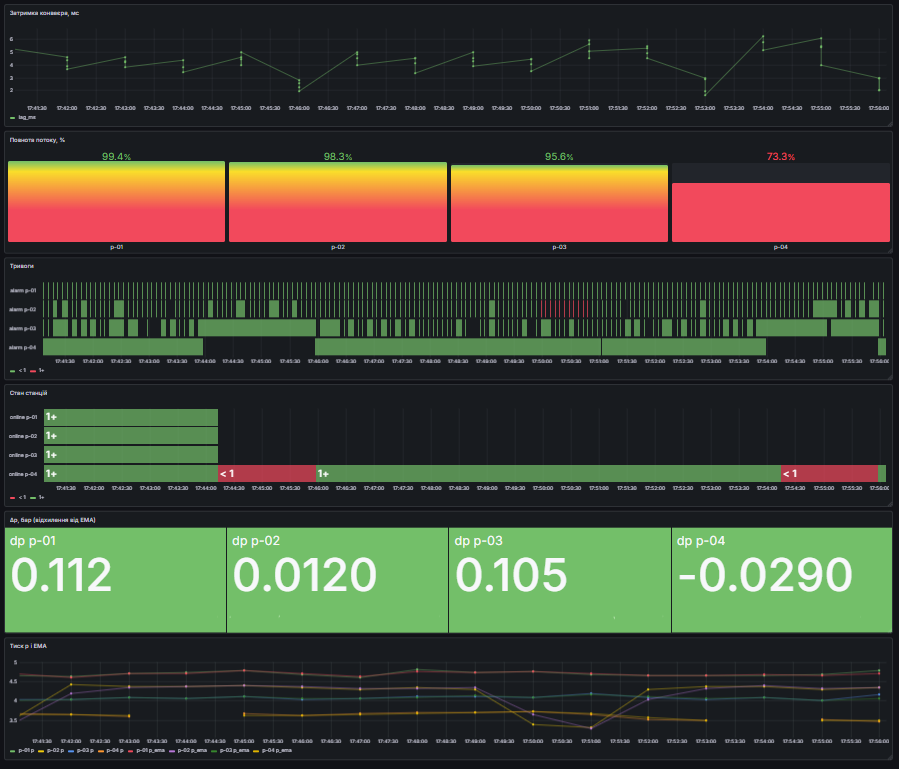
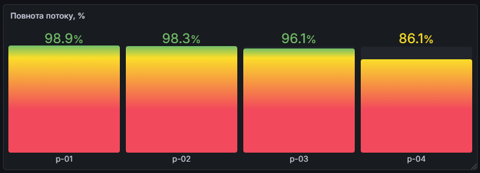
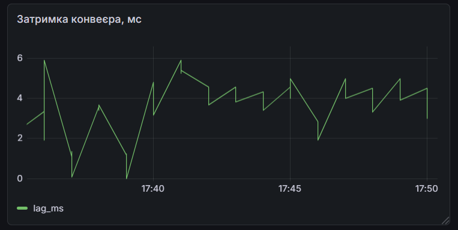
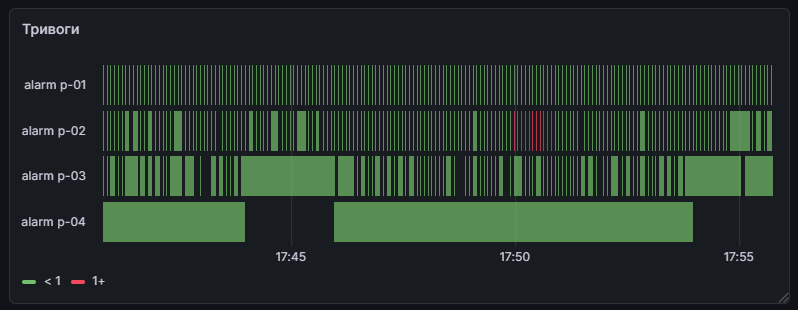
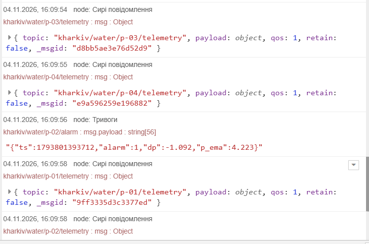
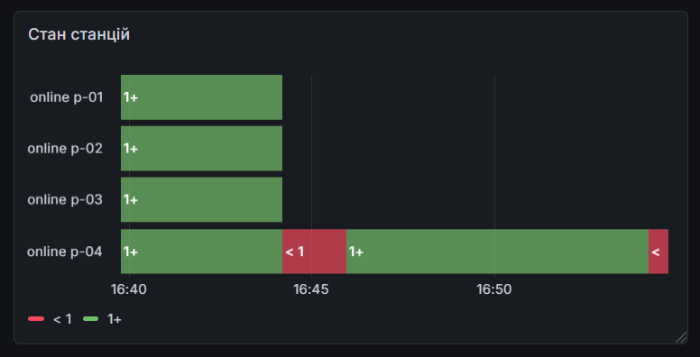
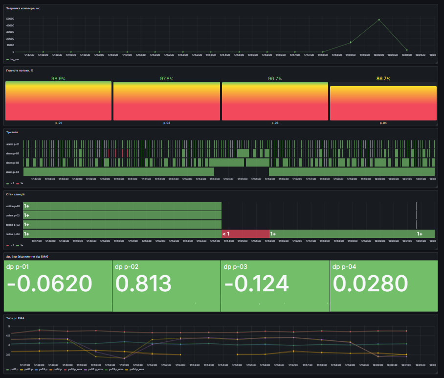
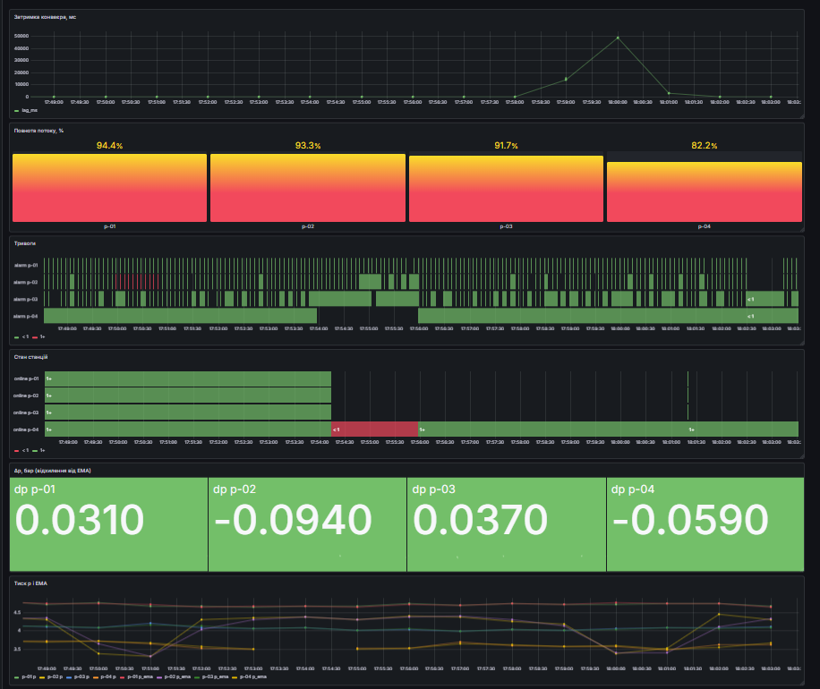
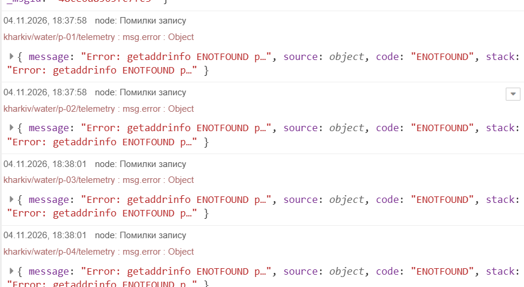

# ПР5. IoT-конвеєр міської інфраструктури

**Студент:** Костюченко А. В., група М УП(кн) 2026-1
**Варіант:** № 8 - тиск у водопровідній мережі
**Дата:** 04.11.2026

Конвеєр: датчики (симулятор) → MQTT (Mosquitto) → Node-RED → PostgreSQL → Grafana, розгорнутий однією командою `docker compose up -d`.

## 1. Архітектура

Схема конвеєра: чотири вузли мережі p-01…p-04 публікують тиск і витрату в брокер Mosquitto; Node-RED перевіряє дані, обчислює показник варіанта (Δp) і відхилення витрати (Δq), згладжує обидва ряди, визначає тривогу (падіння тиску разом зі зростанням витрати) з гістерезисом і записує результат у PostgreSQL; Grafana на SQL-запитах показує стан мережі.

| Сервіс | Образ | Порт (хост) | Призначення |
|---|---|---|---|
| mosquitto | eclipse-mosquitto:2.0.22 | 1883 | MQTT-брокер |
| postgres | postgres:16 | 5433 | база даних |
| nodered | pr5-nodered:4.1 (з `nodered/Dockerfile`) | 1880 | обробка потоку |
| grafana | grafana/grafana:12.4 | 3000 | візуалізація |

Паролі зберігаються у файлі `.env`, якого немає в репозиторії (є лише `.env.example`). Версії образів зафіксовано для відтворюваності.

## 2. Модель даних

### 2.1. Схема тем MQTT

| Тема | Хто публікує | Вміст | QoS / retain |
|---|---|---|---|
| `kharkiv/water/<id>/telemetry` | вузол кожні 5 с | JSON: `ts`, `p`, `q` | 1 / ні |
| `kharkiv/water/<id>/status` | вузол при підключенні; брокер як Last Will | `online` або `offline` | 1 / так |
| `kharkiv/water/<id>/alarm` | Node-RED при зміні стану тривоги | JSON: `ts`, `alarm`, `dp`, `p_ema` | 1 / так |

`<id>` — p-01…p-04. Телеметрія без retain, бо старий вимір не потрібен новому підписнику; статус і тривога з retain, бо новий підписник має одразу знати поточний стан.

Приклад повідомлення телеметрії:

```json
{"ts": 1792509494167, "p": 4.87, "q": 183.2}
```

де `ts` - час виміру в мілісекундах від 1970 р. (ставить пристрій), `p` - тиск, бар (діапазон 0–10), `q` - витрата, м³/год (діапазон 0–500).

### 2.2. Схема бази (`postgres/init/01_schema.sql`)

Таблиця `water` - один рядок на один вимір («довгий» формат):

- `PRIMARY KEY (station, ts)` - у вузла не може бути двох вимірів в один момент; разом з `ON CONFLICT DO NOTHING` це робить запис ідемпотентним (захист від дублікатів при повторній доставці QoS 1);
- `ts timestamptz` - момент виміру (зберігається в UTC); `real` - достатня точність для датчика; `smallint` - для прапорця тривоги;
- `CHECK (p BETWEEN 0 AND 10)`, `CHECK (q BETWEEN 0 AND 500)`, `CHECK (alarm IN (0, 1))` - друга лінія захисту якості даних, якщо перевірка в Node-RED пропустить помилку;
- `CREATE INDEX water_ts_idx ON water (ts)` - дашборд завжди відбирає рядки за діапазоном часу;
- `q_ema real` і `dq real` - згладжена витрата та її відносне відхилення від EMA, %; додані після зауваження викладача (витрата використовується у виявленні пориву). Ті самі стовпці є в `01_schema.sql`, тому проєкт відтворюється з нуля. Для вже створеної бази: `ALTER TABLE water ADD COLUMN q_ema real, ADD COLUMN dq real;`.

Таблиця `station_status` зберігає лише зміни стану (`online` 0/1), час запису ставить база (`DEFAULT now()`). Grafana підключається користувачем `grafana_reader`, який має право лише `SELECT` (принцип найменших привілеїв).

### 2.3. Розрахунок навантаження

За формулою (1): M = n · 3600 / Δt = 4 · 3600 / 5 = **2880 повідомлень за годину** (n = 4 вузли, Δt = 5 с).

За формулою (2): V = n · 86 400 / Δt · b = 4 · 17 280 · 100 ≈ **6,9 МБ за добу** (b ≈ 100 байтів на повідомлення разом з темою).

## 3. Обробка потоку

### 3.1. Симулятор (`simulator/simulator.py`)

Чотири вузли з базовими значеннями тиску p₀ і витрати q₀:

| Вузол | p₀, бар | q₀, м³/год |
|---|---|---|
| p-01 | 5,2 | 220 |
| p-02 | 4,8 | 180 |
| p-03 | 4,5 | 150 |
| p-04 | 4,0 | 120 |

Модель значення - добовий профіль (формула (3)) з піком споживання о 19:00: витрата вища на 35 %, тиск нижчий на 10 %; інерційність AR(1) (формула (4)) з φ = 0,8, σ_p = 0,05 бар, σ_q = 3 м³/год. Типовий тиск у міських мережах 3–6 бар, пік споживання вранці та ввечері, у пік тиск просідає; шум порядку одиниць відсотків відповідає промисловим датчикам.

Сценарій (цикл 10 хв): на 2–4 хв - порив біля p-02 (тиск −1 бар, витрата ×1,3, тобто Δq ≈ +30 %); на 6–8 хв - знеструмлення p-04 (вузол замовкає без DISCONNECT); ≈ 2 % вимірів - збої сенсора (`p` = −1 або 99, `q` = −1 або 9999). Last Will: `offline` з retain, keep-alive 10 с.

### 3.2. Формули

**Перевірка коректності (5):** вимір коректний, якщо 0 ≤ p ≤ 10 ∧ 0 ≤ q ≤ 500 і `ts` - ціле число. Інакше вимір відхиляється на другий вихід вузла.

**Показник варіанта (В8):** Δp_t = p_t − s_{t−1}, де s_{t−1} - згладжене значення до цього виміру. Різке падіння тиску разом зі зростанням витрати - ознака пориву; зростання витрати оцінюється відносно її власної EMA (формула (8а)).

**Згладжування (8):** s_t = α·p_t + (1 − α)·s_{t−1}, s₁ = p₁, α = 0,2 (згладжене значення відповідає середньому за ≈ 9 вимірів, тобто ≈ 45 с).

**Згладжування і відхилення витрати (8а):** r_t = α·q_t + (1 − α)·r_{t−1}, r₁ = q₁, α = 0,2; Δq_t = (q_t − r_{t−1}) / r_{t−1} · 100 %. У базі: `q_ema` = r_t, `dq` = Δq_t.

**Тривога з гістерезисом (9):** тривога вмикається при Δp ≤ θ_on = −0,5 бар **і** Δq ≥ +10 %; вимикається при Δp ≥ θ_off = −0,2 бар (стан після вмикання залежить лише від Δp, тому всередині епізоду Δq може бути вже нижчим за 10 %); між порогами стан не змінюється. Якщо тиск упав (Δp ≤ −0,5), а витрата не зросла (Δq < +10 %), тривога не вмикається, а вузол виводить в налагодження Node-RED попередження «не порив».

**Затримка конвеєра (10):** L = t_зап − t_вим, мс.

**Повнота потоку (11):** P = N / (T / Δt) · 100 %.

**Виявлення відмови (12):** t_вияв ≈ 1,5 · k, при keep-alive k = 10 с це ≈ 15 с.

### 3.3. Ручна перевірка (за двома послідовними рядками таблиці `water`)

Взято два послідовні рядки станції p-02 (запит з віконною функцією `lag()`, знімки у звіті, рис. 67-68):

| ts (UTC) | p | p_ema | dp | q | q_ema | dq | alarm |
|---|---|---|---|---|---|---|---|
| 15:46:30.925 | 4,3 | 4,264 | 0,045 | 238,4 | 237,2 | 0,6 | 0 |
| 15:46:35.928 | 3,31 | 4,073 | -0,954 | 308 | 251,4 | 29,8 | 1 |

Значення другого рядка перераховано вручну з **першого** рядка (s_{t−1} = 4,264, r_{t−1} = 237,2) і виміряних p_t = 3,31, q_t = 308:

- Δp_t = p_t − s_{t−1} = 3,31 − 4,264 = **−0,954** (у базі `dp` = −0,954);
- s_t = 0,2 · 3,31 + 0,8 · 4,264 = 0,662 + 3,411 ≈ **4,073** (у базі `p_ema` = 4,073);
- Δq_t = (308 − 237,2) / 237,2 · 100 % ≈ **+29,8 %** (у базі `dq` = 29,8);
- r_t = 0,2 · 308 + 0,8 · 237,2 = 61,6 + 189,8 ≈ **251,4** (у базі `q_ema` = 251,4).

Усі значення збігаються. Δp = −0,954 ≤ −0,5 і Δq = +29,8 % ≥ +10 %, тому тривога ввімкнулась (`alarm` 0 → 1). Вимкнення перевірено так само (рядок 15:47:15.953): s_{t−1} = 3,457, Δp = 3,3 − 3,457 = −0,157 ≥ −0,2, s_t = 0,2 · 3,3 + 0,8 · 3,457 ≈ 3,426 (у базі 3,426), `alarm` 1 → 0.

Зауваження до першої версії роботи: тоді s_{t−1} відновлювалось із виведених вузлом `p_ema` і `dp`, і результат збігався б за будь-яких чисел. Тепер s_{t−1} береться з попереднього рядка таблиці.

### 3.4. Обґрунтування порогів

Робочий тиск вузла p-02 ≈ 4,8 бар, поріг увімкнення −0,5 бар - це ≈ 10 % робочого тиску і ≈ 5σ типового коливання Δp (спостережувані |Δp| у нормі ≲ 0,1 бар), тому випадкові коливання тривогу не вмикають. Поріг вимкнення −0,2 бар лежить вище шуму; зона між порогами (0,3 бар) не дає тривозі «блимати». Поріг +10 % для Δq утричі нижчий за очікуваний стрибок витрати під час пориву (+30 %) і значно вищий за шум витрати (σ_q = 3 м³/год при q ≈ 240, тобто ≈ 1,3 %). Якби пороги зблизити (наприклад, −0,5 і −0,45) або взяти один поріг, Δp, що коливається біля нього, вмикало б і вимикало тривогу кожні кілька секунд.

Властивість показника: оскільки s_{t−1} «наздоганяє» новий нижчий тиск, Δp повертається до нуля за ≈ 8 вимірів (≈ 40–45 с), і тривога вимикається, хоча порив триває 2 хв. Показник ловить момент падіння тиску, а не стан «тиск низький»; тому тривога спрацьовує рівно один раз на епізод.

### 3.5. Перевірка негативного випадку: тиск упав, а витрата не зросла

Для p-01 (стан перед тестом: `p_ema` = 4,669, `q_ema` = 293,8) вручну надіслано повідомлення з тиском 3,59 бар і витратою 298,6:

```bash
docker compose exec mosquitto mosquitto_pub -h localhost -t "kharkiv/water/p-01/telemetry" -m "{\"ts\": $(date +%s%3N), \"p\": 3.59, \"q\": 298.6}"
```

Результат: у налагодженні Node-RED з'явилось попередження `p-01: тиск упав (Δp=-1.12), витрата не зросла (Δq=1.6 %): не порив`; запит `SELECT ts, station, p, dp, dq, alarm FROM water WHERE alarm = 1 AND station = 'p-01';` повернув 0 рядків. Отже лише падіння тиску (Δp = −1,12 ≤ −0,5) без зростання витрати (Δq = +1,6 % < +10 %) тривоги не вмикає.

## 4. Дашборд

Файл: `grafana/dashboards/pr5.json` (7 панелей), знімок: `reports/figures/dashboard.png`.



| Панель | Тип | SQL |
|---|---|---|
| Тиск p і EMA | Time series | `SELECT $__timeGroupAlias(ts, $__interval), station, avg(p) AS p, avg(p_ema) AS p_ema FROM water WHERE $__timeFilter(ts) GROUP BY 1, 2 ORDER BY 1` |
| Δp, бар (відхилення від EMA) | Stat | `SELECT ts AS "time", station, dp FROM water WHERE $__timeFilter(ts) ORDER BY 1` |
| Стан станцій | State timeline | стан на початок діапазону (`DISTINCT ON (station)`) `UNION ALL` зміни стану з `station_status` |
| Тривоги | State timeline | `SELECT ts AS "time", station, alarm FROM water WHERE $__timeFilter(ts) ORDER BY 1` |
| Повнота потоку, % | Bar gauge | `SELECT max(ts) AS "time", station, 100.0 * count(*) * 5 / ($__unixEpochTo() - $__unixEpochFrom()) AS completeness FROM water WHERE $__timeFilter(ts) GROUP BY station ORDER BY 1` |
| Витрата q і EMA | Time series | `SELECT $__timeGroupAlias(ts, $__interval), station, avg(q) AS q, avg(q_ema) AS q_ema FROM water WHERE $__timeFilter(ts) GROUP BY 1, 2 ORDER BY 1` |
| Затримка конвеєра, мс | Time series | `SELECT $__timeGroupAlias(ts, $__interval), station, avg(lag_ms) AS lag_ms FROM water WHERE $__timeFilter(ts) GROUP BY 1, 2 ORDER BY 1` |

Результати за дашбордом (діапазон 15 хв):

- затримка конвеєра в нормі 1–6 мс (формула (10));
- повнота потоку (формула (11)): p-01 - 98,9 %, p-02 - 98,3 %, p-03 - 96,1 %, p-04 - 86,1 % (інший знімок: 99,4 / 98,3 / 95,6 / 73,3 %). Втрати p-01…p-03 (≈ 1–4 %) - це відхилені збої сенсора. Для p-04 повнота залежить від того, скільки епізодів знеструмлення потрапило у вікно: 13/15 = 86,7 % при одному двохвилинному епізоді і 11/15 = 73,3 % при двох;
- тривога на p-02 спрацьовує один раз у кожному циклі (≈ 45 с), на інших вузлах не спрацьовує; під час пориву витрата на p-02 зростає приблизно з 235 до 310 м³/год (панель «Витрата q і EMA»); показник Δp на p-02 досягав −0,512 бар (червона плитка, поріг −0,5) і −0,322 бар (жовта).






## 5. Експеримент зі стійкістю

| Експеримент | Хто зберіг дані | Розрив на графіку | Патерн із Лекції 5 |
|---|---|---|---|
| А. Знеструмлення p-04 | Ніхто (пристрій не вимірював) | так, ≈ 2 хв | Last Will, плавна деградація (`offline` замість «немає даних») |
| Б. Зупинка Node-RED на ≈ 60 с | Брокер (постійна сесія, QoS 1) | ні | «Зберегти–переслати» на рівні брокера |
| В. Зупинка PostgreSQL на ≈ 60 с | Ніхто | так | потрібен буфер «зберегти–переслати» в Node-RED |



**А.** Записи p-04 за хвилинами (час UTC): о 16:33 - 11 записів, о 16:34 - 0 (рядків немає), о 16:35 - 1, о 16:36 - 12. Нормальна кількість - 12 записів на хвилину (формула (1)); отже станція мовчала ≈ 2 хв. Час виявлення відмови брокером визначено за таблицею `station_status` (час UTC): `offline` для p-04 фіксувався о 15:14:10, 15:24:11, 15:34:12, 15:44:13, 15:54:14, а повернення `online` - о 15:15:55, 15:25:56, 15:35:57, 15:45:58, 15:55:58, тобто інтервал між `offline` і `online` становив 104–105 с. Станція була знеструмлена 120 с за сценарієм, отже брокер виявив відмову через 120 − 105 ≈ **15 с**, що збігається з формулою (12): 1,5 · 10 с = 15 с. Епізод повторюється кожні ≈ 10 хв (період симулятора трохи більший за 600 с через паузи циклу). Менший k дає швидше виявлення, але частіші пакети PINGREQ - більше енергії та трафіку для пристрою на батареї.

**Б.** Постійна сесія (`cleansession: false`, `autoUnsubscribe: false`, незмінний Client ID `nodered-pr5`) і QoS 1: брокер накопичив повідомлення за час зупинки і доставив їх після повторного підключення. На панелі «Тиск» розриву немає, затримка (панель «Затримка») зросла до ≈ 49 000 мс (середнє за хвилину; найстаріше повідомлення очікувало ≈ хвилину) і повернулася до норми 1–6 мс; повнота потоку p-01…p-03 лишилася 96,7–98,9 %.  Повторну доставку відкинув би `ON CONFLICT DO NOTHING`.

**В.** Вузол «PostgreSQL: виміри» отримав помилку з'єднання (`ENOTFOUND postgres` / `ECONNREFUSED`), у вкладці налагодження «Помилки запису» з'явилися повідомлення; на панелі «Тиск» - розрив за весь час зупинки: ці дані втрачено, бо Node-RED не зберігає повідомлення, які не вдалося записати. Після запуску бази запис відновився автоматично. Поки база була зупинена, панелі Grafana показували «No data» (дашборд не може виконати SQL-запити); повнота потоку після відновлення знизилась до 94,4 / 93,3 / 91,7 / 82,2 % (до експерименту - 98,9 / 97,8 / 96,7 / 86,7 %). Кількість записів за хвилину можна перевірити запитом `date_trunc('minute', ts)`.  

**Питання: як змінити конвеєр, щоб експеримент В не призводив до втрати даних?** Варіанти: черга з повторними спробами в Node-RED (вузол delay у режимі обмеження швидкості разом із повторною відправкою після помилки); запис у локальний файл з подальшим досиланням; окремий споживач з власною постійною сесією MQTT, який записує дані в базу лише після успішної вставки. Обсяг буфера на годину відмови за формулою (2): 4 · 720 · 100 Б ≈ 288 КБ, тобто пам'яті потрібно зовсім небагато.

## 6. Творче питання і висновки

**Чи можна визначити, між якими вузлами стався порив, за часом, коли падіння тиску дійшло до кожного вузла? Що для цього потрібно знати про мережу?**
Так: порив створює хвилю падіння тиску, яка поширюється трубами зі швидкістю звуку у воді (≈ 1000–1300 м/с для сталевих і чавунних труб, нижче для пластикових). Вузол, до якого хвиля дійшла першою, найближчий до місця пориву; за різницею часів у двох сусідніх вузлах можна обчислити відстань до пориву вздовж труби. Для цього потрібно знати: топологію мережі (які вузли з'єднані й якими ділянками), довжини, діаметри та матеріал труб (швидкість хвилі), а також мати синхронізовані годинники датчиків (NTP/GPS) і високу частоту вимірювання. У нашому конвеєрі Δt = 5 с, а хвиля проходить ≈ 1 км за 1 с, тому роздільна здатність за відстанню ≈ 5 км - це на порядок гірше за розмір мікрорайону. Для локалізації пориву потрібне вимірювання з періодом ≲ 10 мс (тоді ≈ 10 м). Наша система показує лише, **на якому вузлі** (p-02) відбулося падіння тиску і зростання витрати.

**Висновки:**

1. Розгорнуто конвеєр з чотирьох контейнерів, який обробляє 2880 повідомлень за годину від чотирьох вузлів (формула (1)); затримка від виміру до запису 1–6 мс.
2. Перевірка за формулою (5) відкидає ≈ 2 % вимірів (коди помилок −1, 99, 9999); у нормі записується 12 вимірів за хвилину на вузол, 11 - коли відхилено збій.
3. Епізод пориву на p-02 виявлено за двома ознаками: тиск упав (Δp = −0,954 бар ≤ −0,5) і витрата зросла (Δq = +29,8 % ≥ +10 %); ручну перевірку виконано за двома послідовними рядками таблиці `water` (розд. 3.3), а тест «тиск упав, витрата не зросла» тривоги не вмикає (розд. 3.5); завдяки гістерезису тривога вмикається й вимикається по одному разу за цикл, на інших вузлах не спрацьовує.
4. Відмову p-04 зафіксовано брокером (Last Will) як `offline`; розрив даних ≈ 2 хв; брокер виявив відмову через ≈ 15 с (формула (12)); повнота p-04 - 86,7 % при одному епізоді у 15-хвилинному вікні і 73,3 % при двох. Зупинка Node-RED не призвела до втрати даних (постійна сесія, QoS 1, ідемпотентний запис), зупинка PostgreSQL - призвела, що вказує на потребу в буфері «зберегти–переслати».

**Обмеження.** Дані згенеровано симулятором, а не реальними датчиками; показник Δp ловить лише момент падіння тиску (за ≈ 45 с повертається до нуля); у симуляторі порив одночасно знижує тиск і збільшує витрату, тому умова за q виконується синхронно з умовою за p, а поріг +10 % підібрано під параметри симулятора (у реальній мережі може знадобитися вікно узгодження); частота вимірювання 5 с не дозволяє локалізувати порив за часом приходу хвилі; брокер працює без автентифікації й шифрування (`allow_anonymous true`); Node-RED і PostgreSQL - по одному екземпляру, без резервування; контекст Node-RED (EMA і стан тривоги) зберігається в пам'яті й обнуляється при перезапуску.

## 7. Журнал використання ШІ

- **Інструмент:** Claude
- **Основні запити:** додаткове прояснення моментів де виникали проблеми, прості питання, допомога з помилками Docker.
- **Помилки, знайдені й виправлені:** Docker Hub спочатку не відкривався  - після вирішення проблеми образи завантажилися; CI на GitHub впав, бо flake8 перевіряв `pr5` і `.venv` - додано `--exclude=.venv,pr4,pr5`