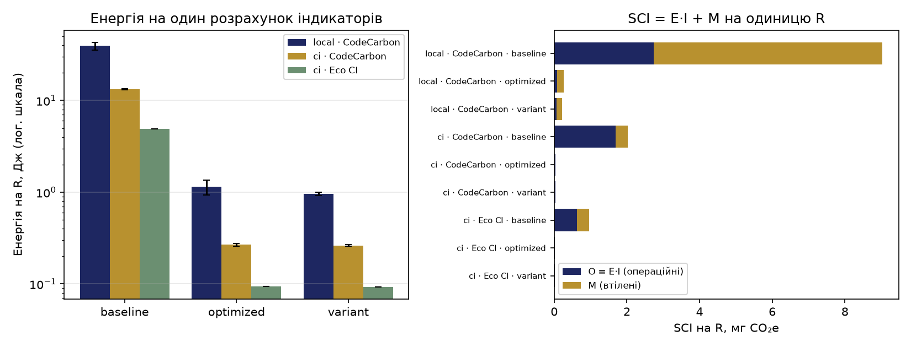

# ПР6. Вимірювання вуглецевої інтенсивності ПЗ

**Студент:** Костюченко Анастасія, група М УП(кн) 2026-1  
**Варіант:** № 8 — кешування залежностей pip у CI (`cache: pip`)  
**Дата:** 12.11.2026

## 1. Об'єкт і функціональна одиниця

Навантаження — розрахунок індикаторів якості повітря за щогодинними
концентраціями PM2.5 (вибірка для двох міст, 2021–2023 рр.): середньорічна
концентрація, кількість валідних днів, днів вище норми, повнота даних і рівень ВООЗ.

**Функціональна одиниця R** — один повний розрахунок індикаторів (одна репліка бенчмарку).

Версії коду:

- `baseline` — базова реалізація (повільна);
- `optimized` — оптимізована реалізація, що дає той самий результат
  (перевірено `python measure.py verify`: «OK: optimized дає той самий результат»);
- `variant` — варіант 8; код не змінювався, змінюється лише конвеєр CI
  (кеш pip), тому `variant` і `optimized` у CI збігаються.

## 2. Середовища і спосіб вимірювання

| | Локально | GitHub Actions |
|---|---|---|
| ОС, процесор | Windows 10, Intel Core i5-1035G1 @ 1,00 ГГц, ноутбук HP 250 G8 | ubuntu-latest (Linux, Azure), 4 vCPU (публічний репозиторій), процесор Intel Xeon Platinum 8370C @ 2,80 ГГц |
| Інструмент | CodeCarbon 3.3.2 | Eco CI v5.3.0 + CodeCarbon 3.3.2 |
| Спосіб для CPU (`measure.py check`) | оцінка: `cpu_load` (за завантаженням і TDP = 15 Вт); RAM = 10 Вт — завжди оцінка | оцінка: `cpu_load` (TDP у вимірюваннях 16 Вт; `check` показує 205 Вт цілого процесора); RAM = 10 Вт |
| Потужність простою, Вт | 11,69 (CodeCarbon) | 11,60 (CodeCarbon); 2,96 (Eco CI) |
| Інтенсивність мережі I, гCO₂e/кВт·год | 250,47 (Україна, Ember 2022) | 458,29 (світ, Ember 2025) |

Формула потужності CodeCarbon у режимі `cpu_load`: P = TDP·(0,1 + 0,9·L³) + P_RAM.
У простої L ≈ 0, тому P ≈ 15·0,1 + 10 = 11,5 Вт, що збігається з виміряними 11,5–12,1 Вт:
значна частина «виміряної» потужності — це стала оцінка RAM.

Вимірювання виконувалось без передавання даних назовні: CodeCarbon працює через
`OfflineEmissionsTracker` (без запитів до зовнішніх API), а в Eco CI задано
`send-data: false` і `display-badge: false`. Так результати не залежать від мережі
й не залишають середовище.

Втілені викиди: ноутбук TE = 238 кгCO₂e, EL = 4 роки. Окремого PCF-звіту для HP 250 G8
не знайдено, тому взято найближчий аналог тієї ж лінійки (HP 250R G9: 280 кгCO₂e усього,
42 кг — етап використання; TE = 280 − 42 = 238) — це **оцінка**. Раннер: частка серверних
викидів за vCPU (1151,7 кгCO₂e · 4/128).

**Джерела параметрів SCI:**

- Вуглецева інтенсивність мережі: Ember, Yearly Electricity Data, через Our World in Data —
  <https://ourworldindata.org/grapher/carbon-intensity-electricity> (Україна 250,47 за 2022 р.;
  світ 458,29 за 2025 р.).
- Втілені викиди ноутбука (аналог для HP 250 G8): PCF HP 250R G9 (280 кгCO₂e, з них 42 кг —
  використання) за даними Bechtle —
  <https://media.bechtle.com/asrc/180712/1c4b3d4ee288fc9434f5175bf56070570/c3/-/c2da43f778ee437d9528aba847448e0c/hp-250r-g9-c3-8-256gb-co2-information>.
- Втілені викиди серверного процесора раннера (AMD EPYC 7763, 1151,7 кгCO₂e): Boavizta, як у коді
  Eco CI v5.3.0.
- Методика: лекція 6 курсу та ISO/IEC 21031:2024 (SCI).

## 3. Результати

Таблиця з `results/summary.csv` (енергія на одну одиницю R, 95 % довірчий інтервал,
час на R, потужність, SCI), рисунок — `reports/figures/energy_sci.png`.

| Джерело | Версія | n | E на R, Дж | ±95 % | t на R, с | P, Вт | SCI на R, мг CO₂e |
|---|---|---|---|---|---|---|---|
| local · CodeCarbon | baseline | 5 | 39,389 | 3,775 | 3,3311 | 11,81 | 9,0255 |
| local · CodeCarbon | optimized | 5 | 1,148 | 0,216 | 0,0954 | 11,98 | 0,2599 |
| local · CodeCarbon | variant | 5 | 0,962 | 0,043 | 0,0832 | 11,56 | 0,2239 |
| ci · CodeCarbon | baseline | 3 | 13,303 | 0,130 | 1,1650 | 11,42 | 2,0259 |
| ci · CodeCarbon | optimized | 3 | 0,268 | 0,010 | 0,0223 | 12,03 | 0,0405 |
| ci · CodeCarbon | variant | 3 | 0,263 | 0,005 | 0,0222 | 11,84 | 0,0398 |
| ci · Eco CI | baseline | 1 | 4,882 | — | 1,1930 | 4,09 | 0,9619 |
| ci · Eco CI | optimized | 1 | 0,094 | — | 0,0229 | 4,09 | 0,0185 |
| ci · Eco CI | variant | 1 | 0,093 | — | 0,0227 | 4,09 | 0,0183 |

Для Eco CI n = 1 (результати одного запуску), тому довірчий інтервал не обчислюється.

## 4. Порівняння «локально — CI»

- **Економія і прискорення** optimized відносно baseline: локально 97,1 % і 34,9× (variant: 97,6 % і 40,0×);
  в CI (CodeCarbon) 98,0 % і 52,2×; в CI (Eco CI) 98,1 % і 52,1×. Відносна економія
  в усіх середовищах близька, абсолютні значення різні.
- **Eco CI проти CodeCarbon на тому самому раннері:** енергія baseline на R —
  13,303 Дж (CodeCarbon) проти 4,882 Дж (Eco CI), тобто в 2,7 раза; потужність
  11,42 проти 4,09 Вт (в 2,8 раза). Причина — різні моделі: CodeCarbon додає сталі 10 Вт
  на RAM і рахує потужність CPU за TDP і завантаженням, а Eco CI використовує модель,
  побудовану для процесора раннера.
- **Частка втілених викидів M у SCI:** ноутбук — 69,6 % (baseline) і 69,3 % (optimized);
  раннер — 16,4 % (CodeCarbon) і 35,4 % (Eco CI). Для ноутбука переважає M через малу
  операційну енергію й високий TE.

## 5. Власний CI-конвеєр (ПР1–ПР3)

У `ci.yml` додано кроки Eco CI v5.3.0 (`start-measurement` на початку кожного job,
`get-measurement` з мітками, `display-results` наприкінці; `send-data: false`,
`display-badge: false`, `co2-calculation-method: constant`,
`co2-grid-intensity-constant: 458`). Запуск CI #43 після push у main: усі п'ять jobs
успішні, тривалість 1 хв 8 с. Енергія й SCI одного запуску — сума за jobs:

| Job | Мітки, Дж | E, Дж | SCI, мг CO₂e |
|---|---|---|---|
| build-and-test (3.11) | install 28,54 | 28,54 | 5,625 |
| build-and-test (3.12) | install 15,94 | 15,94 | 3,144 |
| build-and-test (3.13) | install 46,23; tests 5,28 | 51,51 | 10,065 |
| build-and-push-image | docker-build 44,45; docker-push 12,45 | 56,90 | 11,256 |
| deploy | terraform-apply 60,74 | 60,74 | 11,479 |
| **Разом за запуск** | | **213,63** | **41,569** |

Дуже короткі кроки (flake8, тести в частині jobs) Eco CI не зафіксував. Матриця Python дає
96,0 Дж (45 %), збірка образу й розгортання — 117,6 Дж (55 %).

**Річна оцінка** за формулою (10): C_рік = N·SCI_запуск, N = n_розр·n_push·n_днів. За
`git log` за 30 днів: 18 комітів за 5 робочих днів, n_push ≈ 3,6 на день (верхня оцінка,
бо кілька комітів могли йти одним push), n_розр = 1, n_днів = 220. Тоді N = 792 запуски на рік,
C_рік = 792·41,569 мг ≈ **32,9 г CO₂e** (енергія ≈ 169 кДж ≈ 0,047 кВт·год). Для прикладу
з лекції (N = 22 000) — ≈ 0,91 кг CO₂e і ≈ 1,3 кВт·год.

**Три способи зменшити слід** (оцінки за припущеннями в дужках):

1. `paths-ignore` для файлів `.md`, каталогів `pr4/`, `pr5/` і `results` — якщо 25 % push
   змінюють лише документацію (припущення; перевіряється `git log --name-only`),
   економія 0,25·32,9 ≈ 8,2 г CO₂e на рік.
2. Матриця Python: одна версія замість трьох на кожен push (три — лише перед злиттям).
   SCI матриці 18,83 мг проти ≈ 6,28 мг для однієї версії: економія ≈ 12,56 мг на запуск
   ≈ 9,9 г на рік (−30 %), ціна — менше покриття тестами.
3. `concurrency` з `cancel-in-progress: true`: якщо кожен десятий запуск скасовується
   приблизно на півдорозі (припущення; 11.11 було 8 комітів за день), економія
   ≈ 0,05·32,9 ≈ 1,6 г на рік.

Кеш pip (розділ 6) доведеного виграшу не дав.

## 6. Варіант

**Що змінено.** У кроці `actions/setup-python` файлу `pr6-energy.yml` додано
`cache: pip` і `cache-dependency-path: pr6/requirements.txt`. Код бенчмарку та
`requirements.txt` не змінювались.

**Результати.** Три запуски «до» (#2–#4) і три «після» з влученням у кеш (#6–#8).
Перший запуск після зміни (#5) заповнює кеш (cache miss), тому не враховується в «після».
Показник — енергія кроку `install` за Eco CI:

| Запуск | Стан | E install, Дж | Тривалість, с |
|---|---|---|---|
| #2 | до | 79,5339 | 19,62 |
| #3 | до | 86,467 | 20,64 |
| #4 | до | 70,7565 | 16,83 |
| #5 | заповнення кешу (не враховано) | 109,076 | 24,77 |
| #6 | після (cache hit) | 77,9599 | 17,71 |
| #7 | після (cache hit) | 89,9738 | 21,73 |
| #8 | після (cache hit) | 94,9233 | 20,84 |

За n = 3 і t = 4,303: Ē_до = 78,92 Дж (s = 7,87; інтервал 78,92 ± 19,56), Ē_після = 87,62 Дж
(s = 8,72; інтервал 87,62 ± 21,67). Економія S = (1 − 87,62/78,92)·100 % ≈ **−11,0 %**,
тобто в середньому крок не став економнішим. Інтервали перекриваються, t-критерій Велча
дає t ≈ 1,28, p ≈ 0,27 — **різниця не доведена**. Тривалість кроку теж не зменшилась
(19,0 с до та 20,1 с після). Річний ефект ΔE_рік = N·(Ē_до − Ē_після): для власного N = 792 це ≈ −6,9 кДж
≈ −0,0019 кВт·год, для N = 22 000 (лекція) — ≈ −0,053 кВт·год, тобто економії в межах
похибки немає.

**Локально variant** виміряно теж (`python measure.py run variant`, n = 5, R = 1206):
E = 0,962 ± 0,043 Дж на R, економія 97,6 %, прискорення 40,0×, SCI = 0,2239 мг. Код `variant.py`
не змінювався, тому відмінність від `optimized` (1,148 ± 0,216 Дж) — шум (одне вимірювання
optimized зазнало впливу фону); інтервали перекриваються.

> Запуск #1 (автоматичний після push) завис у черзі через затримку на боці GitHub і
> не враховувався; замість нього виконано ручні запуски Run workflow.

**Творче питання.** *Кеш pip зберігає завантажені пакети, але встановлення все одно
виконується. Що ще можна кешувати і яку ціну має кеш (місце, «застарілі» залежності)?*

Крім завантажених пакетів кешувати можна готове віртуальне середовище, зібрані колеса
(wheels), шари Docker-образу, результати збірки та тестів, а також проміжні дані для
тестів. Кеш pip прибирає лише мережеве завантаження; розпакування й установлення
пакетів залишаються, тому на невеликому кроці `install` (≈ 20 с) виграш мізерний,
а шум вимірювання (±20 Дж) його перекриває, що й показав експеримент. Ціна кешу:
місце (у GitHub є ліміт на розмір кешу репозиторію, старі кеші видаляються),
«застарілі» залежності (кеш тримає старі версії, доки не зміниться ключ, тобто
`requirements.txt`), додаткові кроки збереження й відновлення, які теж коштують енергії,
і ризик невідтворюваності, коли результат залежить від стану кешу. Кеш виграє, коли
залежностей багато, а запусків часто; майже нічого не дає, коли залежностей мало.

## 7. Висновки й обмеження

1. Оптимізована версія споживає на одиницю R в 34,9–52,2 раза менше енергії, ніж базова
   (економія 97,1–98,1 % у трьох джерелах); локальний SCI знизився з 9,0255 до 0,2599 мг CO₂e.
2. Абсолютні оцінки залежать від інструмента: на одному раннері CodeCarbon дає енергію
   baseline в 2,7 раза більшу, ніж Eco CI (13,303 проти 4,882 Дж), а відносна економія
   збігається (98,0 % проти 98,1 %).
3. Кешування pip (варіант 8) не дало доведеної економії кроку `install`: −11,0 %, p ≈ 0,27.
   Власний CI: 213,63 Дж і 41,569 мг CO₂e на запуск, ≈ 32,9 г CO₂e на рік (N = 792).
4. Обмеження: `cpu_load` — оцінка, а не вимірювання; RAM у моделі — стала оцінка 10 Вт;
   потужність у режимах idle/baseline/optimized майже однакова (11,7–12,0 Вт), тому
   різниця між версіями виникає через кількість повторів за час; TE ноутбука 238 кг —
   оцінка за аналогом (PCF для HP 250 G8 немає); регіон раннера невідомий, тому
   I = 458,29 (світове значення); для України використано дані за 2022 р.;
   у CI по три запуски на групу, інтервали широкі (t = 4,303), у Eco CI n = 1; одне
   локальне вимірювання optimized (13,1 Вт, 180 повторів) зазнало впливу фону (розкид E ≈ 12 %).

## 8. Використання ШІ

Не використовувався
---
Дані: «Щогодинні концентрації PM2.5…» (ГО «SaveDnipro», data.gov.ua,
CC BY), вибірка для Києва і Харкова, 2021–2023 рр.
